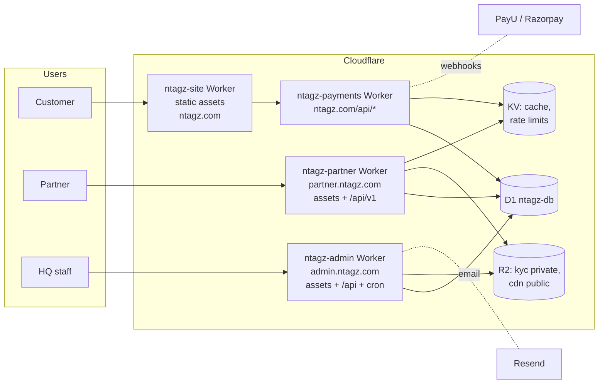
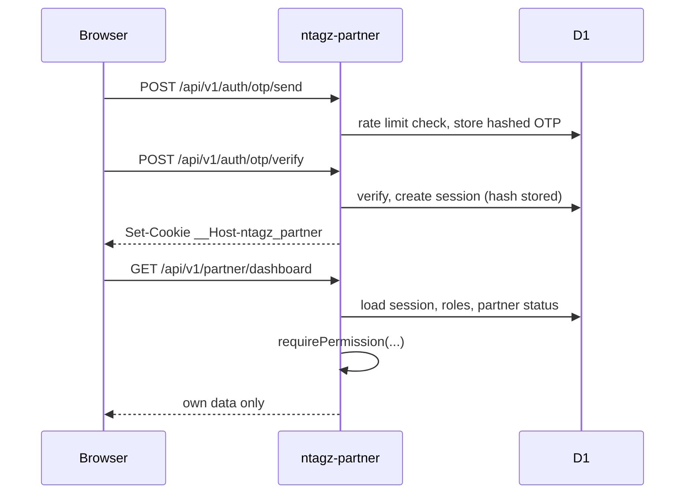

# Architecture (v0.1)

Hosting: Cloudflare only. GitHub is source control and CI. One D1 database, one shared code package, a handful of Workers. Modular monolith: no microservices.

## 1. System diagram



Shared code lives in `packages/platform-core` (auth, permissions, validation, audit, error format, DB helpers) and is bundled into each Worker by wrangler. No Worker calls another over HTTP for core logic.

## 2. Repo layout (added inside this repo; nothing live is moved)

```
apps/partner-portal/        Preact + TypeScript UI for partner.ntagz.com
workers/partner/            ntagz-partner Worker (API + serves the portal build)
workers/site/               ntagz-site Worker config (assets from dist/)
packages/platform-core/     auth, RBAC, errors, audit, db helpers
packages/shared-types/      request/response schemas and permission keys
packages/ui/                design tokens + shared components (new apps only)
admin/                      existing HQ Worker, extended
functions/                  existing payments Worker source
admin/migrations/           all D1 migrations, from 0021
docs/platform/              these documents
tests/                      cross-app end-to-end tests
```

## 3. Request flow: partner



## 4. Security principles

Permissions enforced in every handler. Records scoped by `partner_id` in the SQL `WHERE`, not after fetching. Not-found is returned for other people's records. KYC files in a private R2 bucket via short-lived signed URLs, with every access logged. Webhooks verify signatures and are idempotent. Secrets only through `wrangler secret`. Staging uses a separate D1 and test payment keys.

## 5. Agent ownership map

| Agent | Owns | Must not touch |
|---|---|---|
| CTO | `docs/platform/`, `packages/shared-types`, reviews every PR | feature code |
| Database/Backend | `admin/migrations/` from 0021, `packages/platform-core` db parts, `/api/v1` business modules | portal UI |
| Auth/Security | `packages/platform-core/auth`, session and OTP code, MFA | payments logic |
| Customer portal | `account/`, storefront changes, invoices page | partner or admin code |
| Partner portal | `apps/partner-portal`, `workers/partner` UI side | migrations |
| HQ admin | `admin/` UI and routes for new modules | storefront |
| Design system | `packages/ui`, tokens | business logic |
| Integration/QA | `tests/`, regression runs, defect routing | feature code except fixes handed back |
| DevOps | `workers/site`, wrangler configs, CI, runbooks | application logic |
